# ansible-labs

A hands-on Ansible lab where one control node manages two Linux servers on different distro families. It covers the day-to-day systems admin work you'd automate on a real fleet: a standard baseline, health checks, rolling patching, account audits, log collection, drift detection and keeping secrets out of plain text.

Every playbook here was run against real VMs, and the screenshots below are from those runs.

## Lab layout

| Host | OS | Role |
|---|---|---|
| control | Ubuntu 26.04 | Runs Ansible (ansible-core 2.21) |
| node1 | Ubuntu Server 24.04 | Managed server (Debian family) |
| node2 | Rocky Linux 9.8 Minimal | Managed server (Red Hat family) |

All three run in VMware Workstation on a NAT network. Ansible connects over SSH as a dedicated `ansible` service account, using an ed25519 key and passwordless sudo.

Using two distro families on purpose means the same playbooks have to cope with real differences. The SSH service is `ssh` on Ubuntu and `sshd` on Rocky, the admin group is `sudo` vs `wheel`, and the auth log is `/var/log/auth.log` vs `/var/log/secure`. Those differences live in `group_vars`, so the playbooks themselves stay the same.

## Repo structure

```
ansible.cfg              Defaults: inventory, remote user, SSH key
inventory.ini            node1 in [ubuntu], node2 in [rocky], both in [linux]
group_vars/
  linux.yml              Shared settings: timezone, disk threshold, packages
  ubuntu.yml             Ubuntu-specific names (ssh, chrony, sudo, auth.log)
  rocky.yml              Rocky-specific names (sshd, chronyd, wheel, secure)
roles/baseline/          The standard build as a reusable role
site.yml                 Applies the baseline role to all Linux servers
baseline.yml             The original baseline playbook (before the role)
health_check.yml         Disk usage and critical service report
patch.yml                Rolling patching, one server at a time
audit.yml                Local accounts and admin access audit
collect_logs.yml         Pulls error and auth logs back to the control node
templates/               Report templates and SSH hardening config
vault.yml                Encrypted with Ansible Vault
```

## 1. Inventory and access

The inventory groups servers by distro, with a parent `linux` group over both.

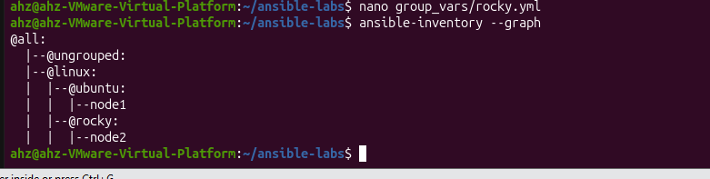

Each node has an `ansible` account with sudo rights from its own file in `/etc/sudoers.d`, checked with `visudo -c`.

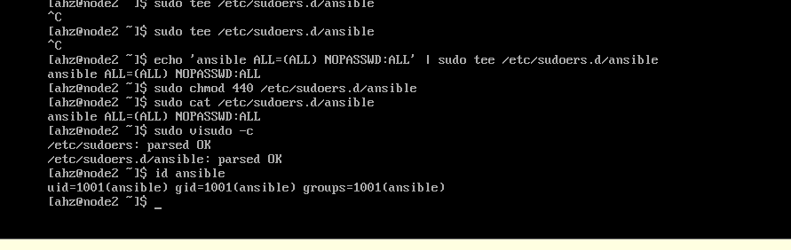

The control node connects with an SSH key, and sudo works without a password prompt.

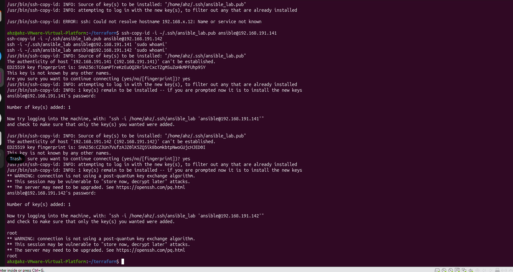

## 2. Baseline (`baseline.yml`, then `roles/baseline`)

The baseline is the standard config every server should have:

- Standard packages (curl, git, tree, chrony, plus distro-specific ones)
- Time sync running and enabled on boot
- Timezone set to Australia/Sydney
- An `opsadmin` account in the right admin group for each distro
- SSH hardening: no root login, no password logins, max 3 auth tries
- A login banner showing the host and OS

SSH hardening goes in a drop-in file, `/etc/ssh/sshd_config.d/00-baseline.conf`, instead of editing `sshd_config` directly. Both distros read that folder first, so the `00-` prefix makes sure these settings win over anything else in there. The template is checked with `sshd -t` before it's written, and a handler restarts SSH only when the config actually changes.

**Check mode first.** `--check --diff` shows what would change without changing anything:

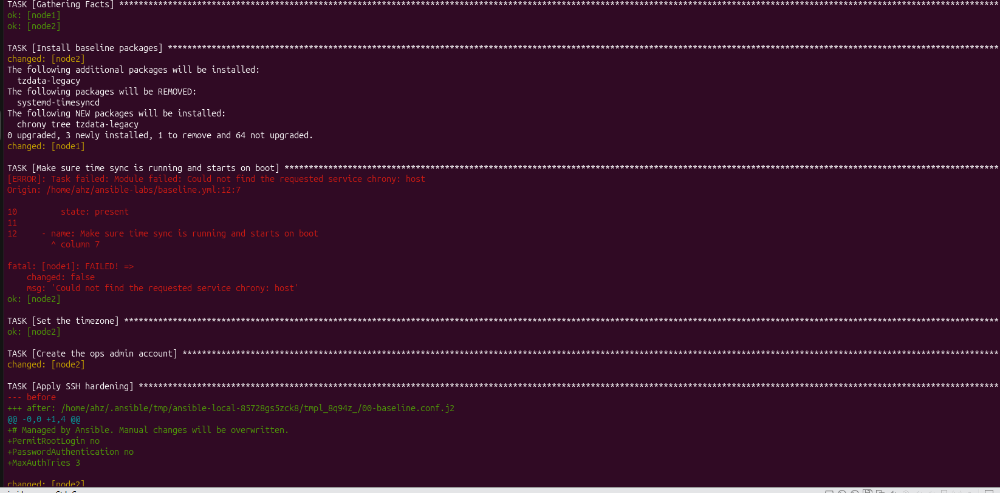

That dry run failed on node1, and it was a useful lesson. Check mode only pretended to install chrony, so the next task couldn't find the chrony service. The real run worked fine. Check mode is great for spotting drift, but it can't fully predict a task that depends on an earlier change actually happening.

**Idempotency.** The second run changed nothing, and the SSH handler didn't fire:

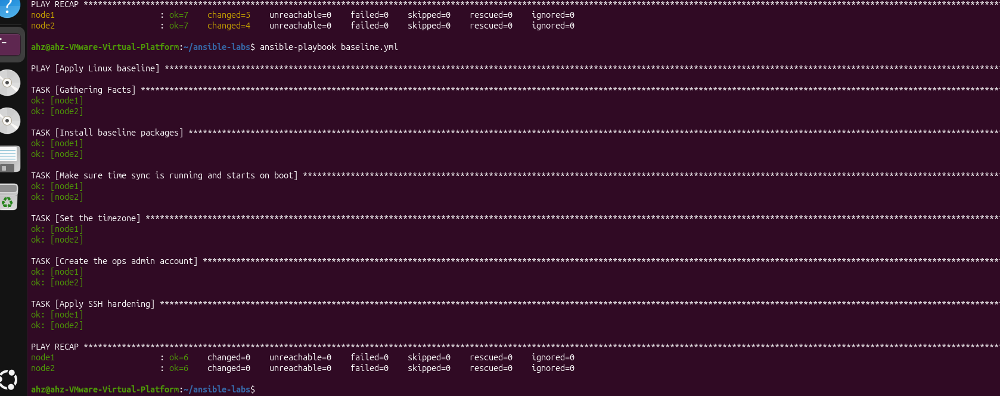

**Proving the hardening works.** Password logins are now refused:

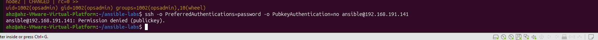

Timezone, time sync and the admin account are correct on both distros:

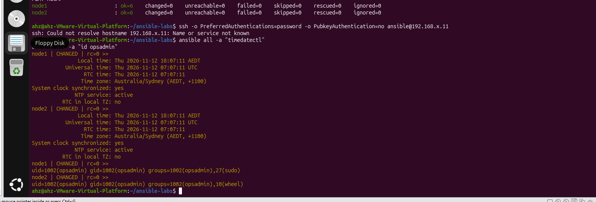

## 3. Health check (`health_check.yml`)

Gathers facts and service state from every server, flags disks over a threshold and critical services that are down, and writes a report per host to the control node.

To test it, I stopped `cron` on node1 and dropped the threshold to 10%:

```
ansible node1 -b -a "systemctl stop cron"
ansible-playbook health_check.yml -e disk_warn_pct=10
```

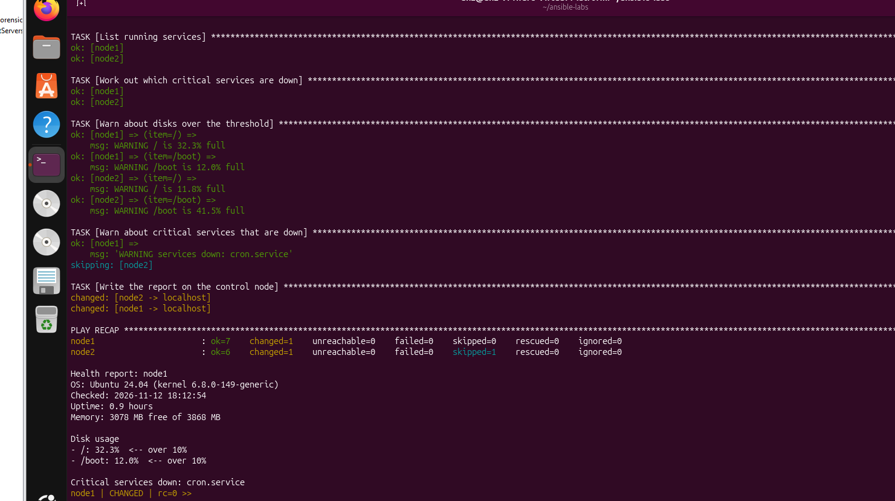

## 4. Rolling patching (`patch.yml`)

Patches one server at a time with `serial: 1`. For each server it:

1. Records the kernel version
2. Patches with apt or dnf, depending on the distro
3. Checks whether a reboot is needed (`/var/run/reboot-required` on Ubuntu, `needs-restarting -r` on Rocky)
4. Reboots only if needed, and waits for the server to come back
5. Asserts the critical services are running again
6. Shows the kernel before and after

If one server fails, the rest haven't been touched yet.

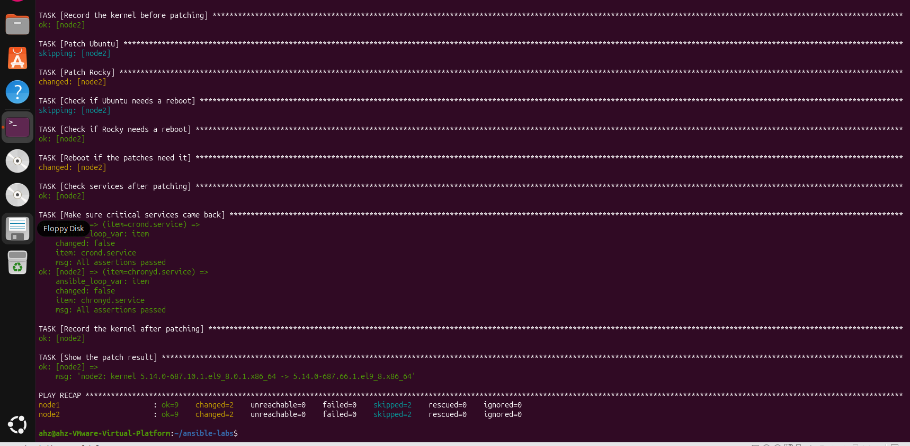

## 5. Account audit (`audit.yml`)

Lists human accounts (UID 1000 to 9999), members of the admin group, and any files in `/etc/sudoers.d`.

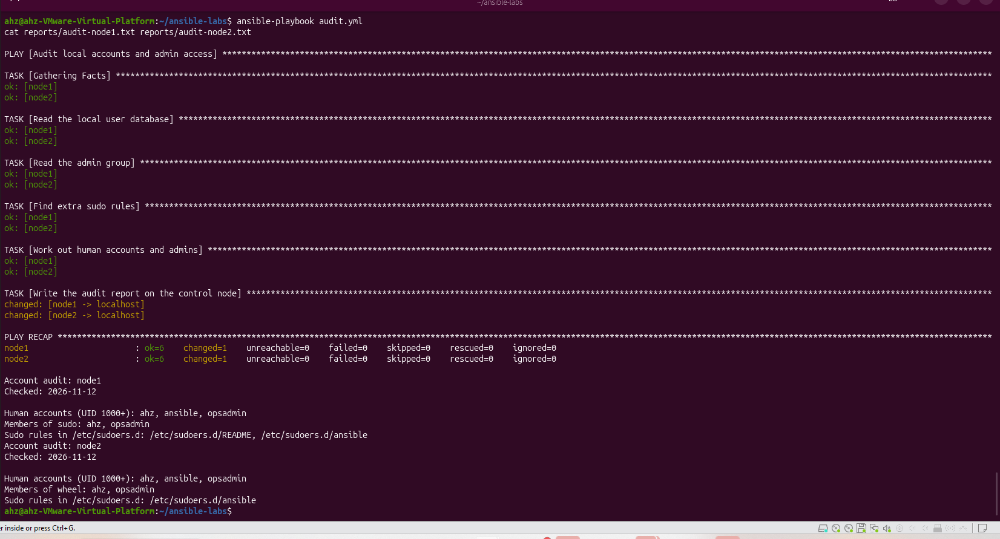

The interesting part: the `ansible` account has full sudo rights but isn't in the `sudo` or `wheel` group. It gets them from `/etc/sudoers.d/ansible`. An audit that only checked group membership would miss it.

## 6. Log collection (`collect_logs.yml`)

Exports the last 24 hours of errors from the journal and pulls each server's auth log back to the control node, using the right log path for each distro.

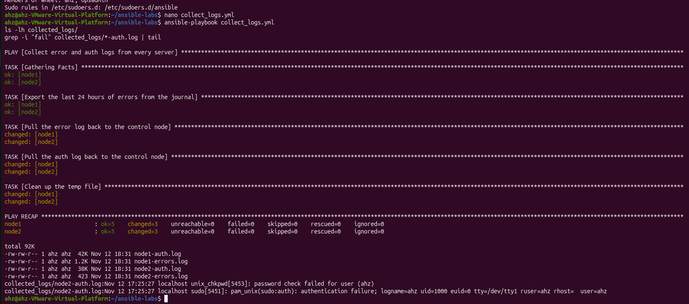

The grep picked up real failed `sudo` attempts on node2 from earlier in the lab, when the admin account hadn't been set up properly yet.

## 7. Baseline as a role (`site.yml`)

The baseline was refactored into `roles/baseline` (tasks, handlers and templates), so any new server just needs `roles: [baseline]`. The login banner is a Jinja2 template filled in from facts:

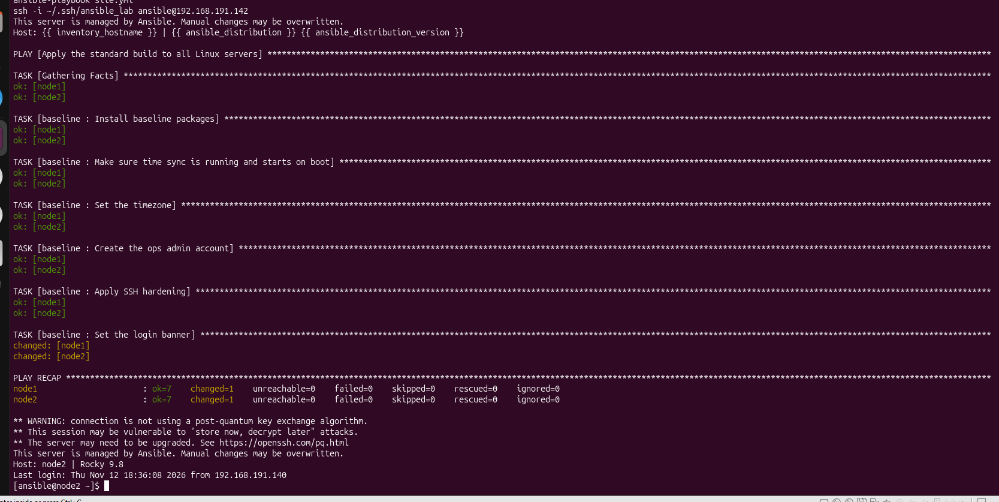

## 8. Drift detection

To simulate someone changing a server by hand, I overwrote node1's SSH hardening file:

```
ansible node1 -b -m ansible.builtin.copy -a "dest=/etc/ssh/sshd_config.d/00-baseline.conf content='PermitRootLogin yes\n'"
```

Running the role in check mode showed exactly what had drifted on node1, and that node2 was still compliant:

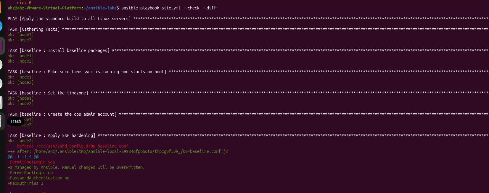

The real run put node1 back to the standard and restarted SSH on node1 only:

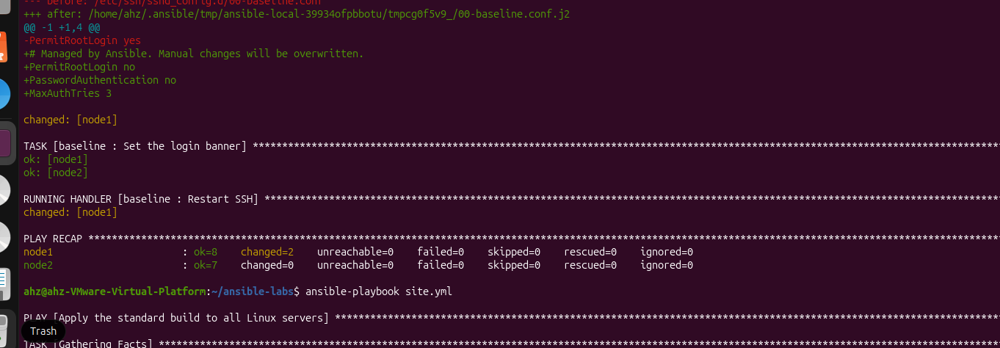

## 9. Secrets with Ansible Vault

The `opsadmin` password hash is stored in `vault.yml`, encrypted with Ansible Vault and loaded through `vars_files`. The vault file is safe to commit because it's encrypted. The vault password isn't stored anywhere in the repo.

```
ansible-playbook site.yml --ask-vault-pass
```

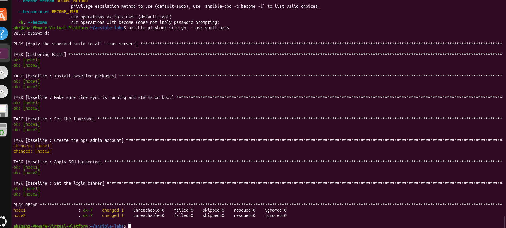

## Running it yourself

1. Build two or more Linux VMs and add them to `inventory.ini`.
2. Create an `ansible` user with key-based SSH and passwordless sudo on each.
3. Create your own vault: `ansible-vault create vault.yml` with an `opsadmin_password_hash` from `openssl passwd -6`.
4. Run:

```
ansible all -m ping
ansible-playbook site.yml --ask-vault-pass
ansible-playbook health_check.yml
ansible-playbook audit.yml
ansible-playbook collect_logs.yml
ansible-playbook patch.yml
```

`reports/` and `collected_logs/` are in `.gitignore`. They're output, and the auth logs hold real usernames and IPs.

## What I'd add next

- Run the health check and drift check on a schedule, so reports happen without anyone running them
- Add a Windows target over WinRM
- Lint everything with `ansible-lint`
- Run it from AWX or a CI pipeline instead of a single control node
